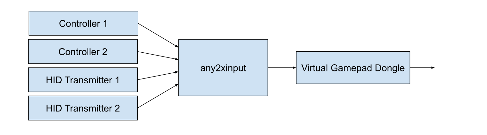
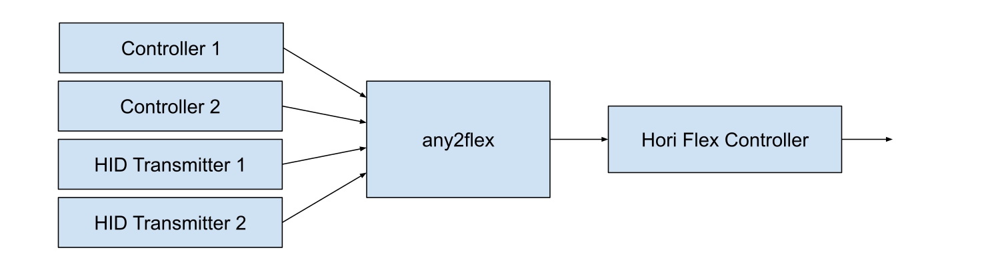

# HID Router

This is a collection of Windows tools that let you redirect and remap gamepad inputs.

Each tool can read inputs from controllers connected to the PC it's running on and can also optionally act as the Receiver component of a [HID Forwarder](https://github.com/jfedor2/hid-forwarder) setup, receiving inputs from some other Transmitter.

You can pick which controllers you want to use and optionally remap the inputs. Then they are fused into one virtual controller and sent to a different output depending on the tool.

* `sdl-transmitter`: acts as the Transmitter component of a [HID Forwarder](https://github.com/jfedor2/hid-forwarder) setup. This lets you send the inputs to another machine over a network or serial link.
* `any2xinput`: sends the inputs to a [Virtual Gamepad Dongle](https://github.com/jfedor2/virtual-gamepad-dongle), creating an XInput-compatible virtual gamepad on your system.
* `any2flex`: sends the inputs to the PC port on a connected Hori Flex Controller. The Flex Controller then sends them out to your Switch or whatever it's plugged into.

For downloads see the [latest release](https://github.com/jfedor2/hid-router/releases/latest).

## License

The software in this repository is licensed under the [MIT License](LICENSE).
